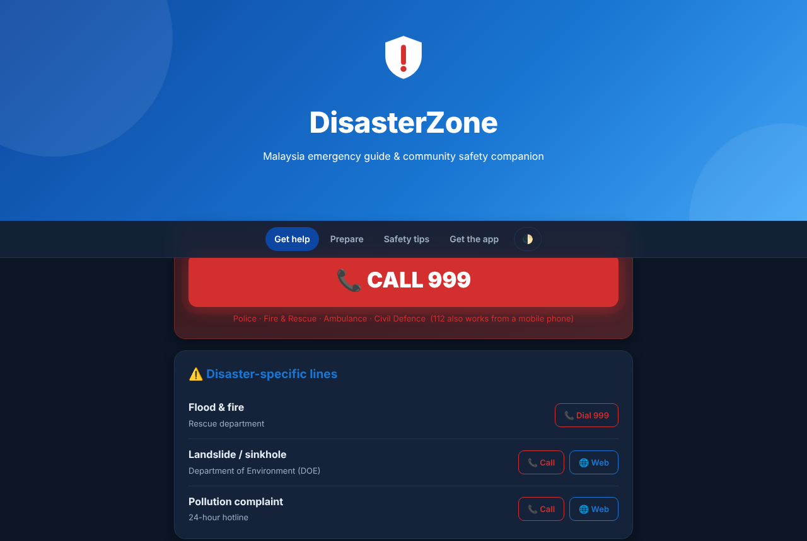

# 🛡️ DisasterZone

A community-driven disaster-awareness app for Malaysia. People photograph and report nearby incidents (floods, fires, landslides …), others see them on a feed and a live map, and the app warns you when you get close to a danger zone. It also bundles an emergency-contact guide.

| | |
|---|---|
| 📱 **Android APK** | [Latest release → `DisasterZone.apk`](https://github.com/YutFi/disasterzone/releases/latest) |
| 🌐 **Web guide (laptop / phone browser)** | https://yutfi.github.io/disasterzone/ |

> The web link works once GitHub Pages is switched on (Settings → Pages → Source: **GitHub Actions**).



## What's in each version

| Feature | Android app | Web guide |
|---|---|---|
| Report an incident with a photo | ✅ | – |
| Live community feed, likes, comments | ✅ (Firebase) | – |
| Danger-zone map (1 km radius) and proximity alerts | ✅ | – |
| QR sharing of a post | ✅ | – |
| Emergency numbers (999, DOE lines) | ✅ | ✅ |
| Readiness checklist (saved on device) | – | ✅ |
| Flood / fire / landslide quick tips | – | ✅ |
| Dark mode, animations, works offline-friendly (no server needed) | – | ✅ |

The live feed, map and alerts depend on Firebase and the phone's GPS, camera and notifications, so they exist only in the Android app. The web page is a standalone guide that works on any laptop.

## Features (Android)

- Email/password sign-up and login (Firebase Authentication)
- Camera report with description and location; posts stored in Firebase Realtime Database
- Feed with active/inactive disasters, likes, comments, post details
- OpenStreetMap-based map (osmdroid) with danger zones
- Background service that raises an alarm notification near a danger zone
- Notifications screen and profile
- **New in 2.0:** smooth slide/fade transitions between every screen, staggered list entrance animations, heart "bounce" on like, animated login/registration entrance. All animations follow the system *remove animations* setting.

## Install the Android app

1. Open the [latest release](https://github.com/YutFi/disasterzone/releases/latest) on your phone and download `DisasterZone.apk`.
2. Allow “install unknown apps” for your browser when asked, then open the file.
3. If an **older DisasterZone build is installed, uninstall it first** – 2.0 is signed with a different key, so Android will not update over it.

The APK is signed with a fixed, public sideload key stored in the repo (`app/dz-sideload.jks`) so every release has the same signature. It is **not** a Play Store key.

## Build it yourself

Requirements: JDK 17, Android SDK 36 (Android Studio recommended).

```
./gradlew assembleRelease     # APK in app/build/outputs/apk/release/
```

CI (`.github/workflows/android-apk.yml`) builds the APK on every push and refreshes the `v2.0` release when `master` is updated. The web guide in `docs/` is deployed by `.github/workflows/pages.yml`.

## Project structure

```
app/src/main/java/com/example/disasterzone/   Activities, adapters, NotificationService, util/Anim (animations)
app/src/main/res/                             Layouts, drawables, anim/ (screen transitions), themes
app/src/main/assets/guide.html                Emergency guide shown inside the app
docs/index.html                               Web guide (GitHub Pages)
```

## Firebase configuration

`app/google-services.json` (project `disasterzone-ae0f7`) is committed so the app builds. Firebase client keys identify the project rather than act as secrets, **but you should protect the project**:

- In the Firebase console set **Realtime Database rules** so only signed-in users can read/write their own data.
- In Google Cloud → APIs & Services → Credentials, **restrict the Android API key** to package `com.example.disasterzone` and the app's signing certificate.
- Using your own Firebase project? Replace `google-services.json` with your own.

## Testing & limitations

- The web guide was tested in headless Chrome (checklist, saved progress, tabs, theme toggle, mobile layout, no console errors).
- The Android project is built by GitHub Actions; **no device or emulator testing** of the app was possible in this update, so please report anything that behaves oddly (especially the new animations).
- The Firebase backend, GPS, camera and notifications could not be exercised outside a real device.
- Emergency numbers and tips are general guidance – always follow instructions from the authorities.

## Housekeeping done in this update

- Removed a signing keystore file that had been committed at the repo root (see below)
- Added CI, README, release APK, animations, and the web guide

> ⚠️ **Security note:** that keystore stays visible in the repository's git history. If it was ever used (or will be used) to sign a Play Store release, treat it as compromised and generate a new one.

## Author

Ariff Lutfi Bin Shahrim (UiTM).
